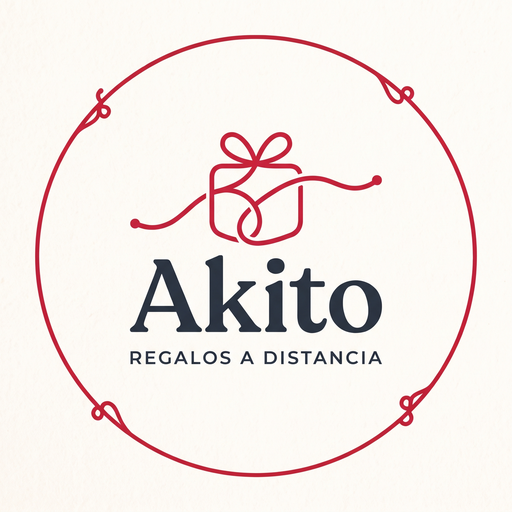

# Akito · Regalos a distancia

**Conectando historias sin importar los kilómetros.**

---

## Qué hacemos

Akito gestiona regalos entre países.

Una persona nos escribe desde su país porque quiere enviarle algo a alguien que vive en otro. Nosotros escuchamos la idea, la aterrizamos, preparamos una cotización y buscamos una **tienda local en el país de destino**. Le compartimos la idea a la tienda, coordinamos la elaboración y el empaque, y gestionamos la entrega hasta que el regalo llega bien.

No vendemos un producto único ni un catálogo rígido: **gestionamos una idea y una entrega entre dos países**.

## El problema

Enviar un regalo al exterior suele terminar en una de estas situaciones:

- No conoces proveedores confiables en el país de destino.
- No sabes cuánto cuesta realmente el producto, la gestión y la entrega.
- No puedes confirmar que el regalo llegue bien ni que se vea como lo imaginaste.
- La idea se pierde entre traducciones, envíos y intermediarios.

Akito existe para quitar esa fricción: una sola conversación, una cotización clara y una tienda local que arma el regalo en destino.

## Cómo funciona

1. **Nos escribes.** Cuéntanos desde qué país escribes, a qué país va el regalo, para quién es, qué idea tienes y para qué fecha lo necesitas.
2. **Entendemos la idea.** Afinamos el detalle, el tono y lo que quieres transmitir. Si no tienes una idea cerrada, la construimos contigo.
3. **Te damos una cotización.** Producto, gestión local, empaque y entrega. Todo claro antes de confirmar.
4. **Buscamos una tienda local en destino.** Validamos que pueda elaborar la idea, los tiempos y la calidad.
5. **Coordinamos con la tienda.** Le compartimos la idea, el nombre de quien recibe, la dedicatoria y los detalles. Revisamos cómo queda.
6. **Confirmas y gestionamos la entrega.** Acordamos valor, fecha y dirección; la tienda arma el regalo y nosotros coordinamos la entrega.
7. **Hacemos seguimiento.** Te contamos cómo avanza y confirmamos la recepción.

## Qué se puede enviar

La idea manda. Según lo que exista en la ciudad de destino, podemos gestionar:

- Detalles personalizados y artesanías.
- Flores, tortas, cestas y desayunos.
- Joyería, accesorios y objetos de diseño.
- Cajas de regalo curadas con productos locales.
- Experiencias y planes para dos o para un grupo.
- Ediciones especiales para fechas concretas.

Si la tienda local no puede hacer exactamente lo que imaginaste, buscamos otra opción o te proponemos una alternativa antes de cotizar.

## Cobertura y confianza

- Trabajamos con **tiendas y artesanos locales en el país de destino**.
- La disponibilidad se confirma en la cotización, según la ciudad y la fecha.
- No prometemos un pedido hasta que el detalle, el valor y la entrega estén acordados.
- Cuidamos los datos de quien envía y de quien recibe; solo se usan para gestionar el regalo.
- El seguimiento es parte del servicio, no un extra.

## Para quién

- Parejas que viven en países distintos.
- Amigos que se mudaron y quieren seguir presentes.
- Familias separadas por la distancia.
- Equipos o marcas que quieren enviar un detalle a alguien en otro país.

## El nombre

**Akito** nace de *Akai* (rojo) e *Ito* (hilo). Recoge la idea del **hilo rojo del destino** y la filosofía del *Musubi*: los vínculos que se entrelazan aunque la distancia sea larga.

Ese hilo es la metáfora del servicio: una persona en un país, otra en otro, y Akito sosteniendo el trazo entre ambas.

## Identidad

### Paleta

| Color | Hex | Uso |
|---|---|---|
| Blanco Marfil | `#FAF7F2` | Fondos limpios, papel de la postal, texto sobre oscuro |
| Azul Crepuscular | `#1A2238` | Titulares, cuerpo, iconos, footer |
| Rojo Carmesí | `#C81E2B` | Hilo, selección, CTA principal |
| Carmesí profundo | `#B81D24` | Hover y pulsación |
| Coral Atardecer | `#E88D67` | Luz cálida, degradados y superficies pictóricas |

### Tipografía

- **Fraunces 600** para titulares y frases emocionales.
- **DM Sans 400 y 600** para cuerpo, pasos, controles y subtítulos.
- Mayúsculas espaciadas (`0.12em`) solo en «REGALOS A DISTANCIA».

### Voz

Íntima, cálida, artesanal y poética, sin clichés empalagosos. Habla de tú. Usa metáforas de hilos, lazos, encuentros y cielos compartidos. No promete un pedido confirmado hasta que Akito lo confirma.

### Logotipo

  
  

- **Logo principal:** `brand/logo-akito.png`, para fondos claros y presentaciones de marca.
- **Logo de perfil:** `brand/logo-perfil.png`, para redes sociales y avatares.
- **Área de protección:** un margen libre equivalente a la altura de la «o» de Akito.
- No deformar, recolorear ni alterar la proporción del trazo.

## Activos

| Archivo | Uso |
|---|---|
| [`brand/logo-akito.png`](brand/logo-akito.png) | Logo principal |
| [`brand/logo-perfil.png`](brand/logo-perfil.png) | Logo de perfil y redes |

## Estado

- [x] Modelo de servicio definido: regalos entre países con tienda local en destino.
- [x] Identidad base y logos.
- [ ] Red de tiendas y artesanos por país.
- [ ] Protocolo de cotización, tiempos y cobertura.
- [ ] Seguimiento y confirmación de entrega.
- [ ] Sitio web y canal de atención.

## Derechos

© 2026 Akito. Todos los derechos reservados.

La identidad y los logos no pueden reutilizarse, modificarse ni distribuirse sin autorización escrita de Akito.
