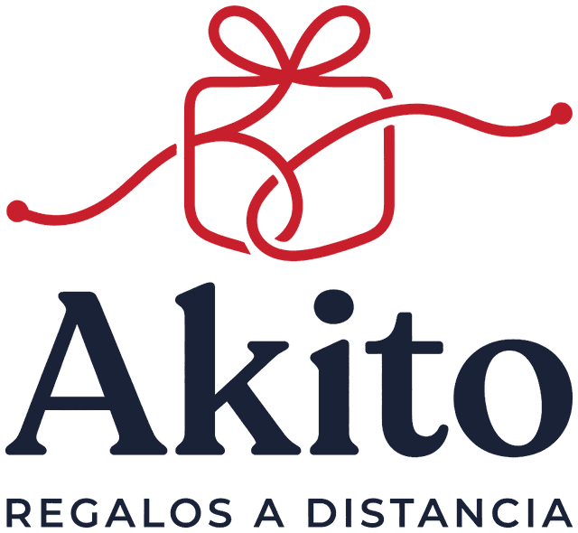

# Akito · Regalos a distancia

**Conectando historias sin importar los kilómetros.**

---

## La idea

Hay personas que viven lejos pero siguen estando en todo lo que piensas. Akito existe para que ese cariño no se quede en un mensaje: se convierta en un regalo que llega, se abre y se siente.

No somos una paquetería ni un catálogo infinito. Somos una marca de **regalos personalizados para parejas y amigos a distancia**. Curamos el detalle, escribimos la dedicatoria contigo y coordinamos la entrega con la persona y la ciudad correctas.

**La promesa:** no enviamos solo una caja; llevamos lo que quieres decirle.

## El nombre

**Akito** nace de *Akai* (rojo) e *Ito* (hilo). El nombre recoge la idea del **hilo rojo del destino** y la filosofía del *Musubi*: los vínculos que se entrelazan aunque la distancia sea larga.

De ahí sale el lenguaje visual de la marca: un trazo carmesí continuo, dos extremos, una caja y una postal. El vacío entre los dos extremos representa los kilómetros.

## Para quién

- Parejas que viven en ciudades o países distintos.
- Amigos que se mudaron y dejaron una rutina compartida.
- Familias que quieren enviar un detalle con intención, no un regalo genérico.
- Personas de 20 a 40 años, en Colombia y Latinoamérica, que valoran lo artesanal y lo emocional por encima de lo masivo.

## Cómo funciona

1. **Elige una intención.** «Te extraño», «Gracias» o «Celebremos». También puedes escribir tus propias palabras.
2. **Escribe tu dedicatoria.** La postal se prepara con tu mensaje y el nombre de quien lo recibe.
3. **Consulta por WhatsApp.** Akito revisa contigo el detalle, el valor y la fecha de entrega. Sin sorpresas.
4. **Akito prepara y envía.** El regalo llega a la ciudad acordada y la conversación sigue abierta hasta la entrega.

## Diferenciales

- **Curaduría, no volumen:** pocas opciones, bien elegidas.
- **Dedicatoria primero:** el regalo empieza por lo que quieres decir.
- **Conversación real:** WhatsApp en lugar de un checkout frío.
- **Claridad antes de confirmar:** detalle, valor y fecha se acuerdan contigo.
- **Narrativa de marca:** el hilo rojo conecta la identidad, el empaque y la experiencia.

## Identidad

### Paleta

| Color | Hex | Uso |
|---|---|---|
| Blanco Marfil | `#FAF7F2` | Fondos limpios, papel de la postal, texto sobre oscuro |
| Azul Crepuscular | `#1A2238` | Titulares, cuerpo, iconos, footer |
| Rojo Carmesí | `#C81E2B` | Hilo, selección, CTA principal |
| Carmesí profundo | `#B81D24` | Hover y pulsación |
| Coral Atardecer | `#E88D67` | Luz cálida, degradados y superficies pictóricas |

### Tipografía

- **Fraunces 600** para titulares y frases emocionales.
- **DM Sans 400 y 600** para cuerpo, pasos, controles y subtítulos.
- Mayúsculas espaciadas (`0.12em`) solo en «REGALOS A DISTANCIA».

### Voz

Íntima, cálida, artesanal y poética, sin clichés empalagosos. Habla de tú. Usa metáforas de hilos, lazos, encuentros, cielos compartidos y detalles hechos a medida. No promete un pedido confirmado hasta que Akito lo confirma.

### Logotipo

- **Versión positiva:** isotipo carmesí + tipografía azul sobre marfil.
- **Versión negativa:** isotipo carmesí + tipografía marfil sobre azul.
- **Isotipo aislado:** para tamaños menores a 40 px, favicons y sellos.
- **Área de protección:** un margen libre equivalente a la altura de la «o» de Akito.
- No deformar, recolorear ni alterar la proporción del trazo.

## Activos

| Archivo | Uso |
|---|---|
| [`brand/logos/logo-positivo.png`](brand/logos/logo-positivo.png) | Fondo claro |
| [`brand/logos/logo-negativo.png`](brand/logos/logo-negativo.png) | Fondo oscuro |
| [`brand/logos/isotipo.png`](brand/logos/isotipo.png) | Marca corta y sellos |
| [`brand/logos/avatar-akito-512.png`](brand/logos/avatar-akito-512.png) | Perfil de redes |
| [`brand/logos/favicon-512.png`](brand/logos/favicon-512.png) | Favicon |
| [`brand/imagery/banner-akito.jpg`](brand/imagery/banner-akito.jpg) | Banner principal |
| [`brand/imagery/hero-left-792.webp`](brand/imagery/hero-left-792.webp) | Manos con la caja, cielo azul |
| [`brand/imagery/hero-right-634.webp`](brand/imagery/hero-right-634.webp) | Manos bajo la luz coral |
| [`brand/manual_de_identidad_de_marca_akito.md`](brand/manual_de_identidad_de_marca_akito.md) | Manual completo de marca |

Los JPG originales están en [`brand/originales/`](brand/originales/).

## Estado

- [x] Concepto, nombre y tono de voz.
- [x] Identidad visual y activos base.
- [ ] Sitio web público.
- [ ] Catálogo de detalles y precios.
- [ ] Fotografía de producto y empaque.
- [ ] Casos reales y testimonios.

## Derechos

© 2026 Akito. Todos los derechos reservados.

La identidad, los logos, las imágenes y el manual no pueden reutilizarse, modificarse ni distribuirse sin autorización escrita de Akito.
